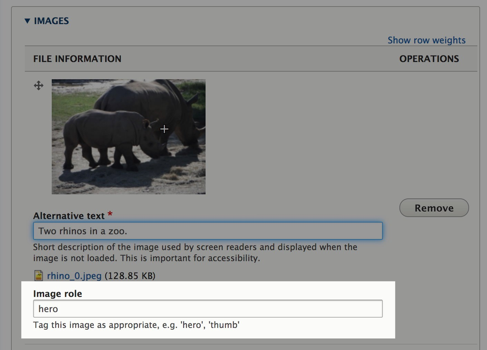
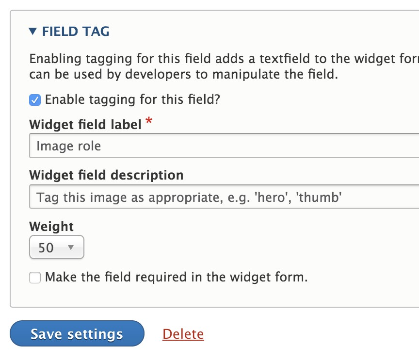

# Field Tags Module



## Summary

Provides a means to attach a tag-style input box to any entity field, which allows content managers to tag the field content. Developers may take advantage of this additional metadata when manipulating fields.

The use case for which this was written is this. Allow the tagging of images on an multiple value image field to indicate which image is the `hero` image, which image is the `thumb` image, and untagged images are just that. It allows the content managers to indicate the role the image is playing for that given entity.

**Visit <https://aklump.github.io/field_tag> for full documentation.**

## About Tags

* The field tag input box is a CSV string separating one or more tags, e.g. `foo` or `foo, bar`.
* Tags are not case-sensitive.
* Tags may contain spaces.
* Tags must be unique; duplicates will be removed.

## Install with Composer

Because this is an unpublished, custom Drupal module, the way you install and depend on it is a little different than published, contributed modules.

* Add the following to the **root-level** _composer.json_ in the `repositories` array:
    ```json
    {
     "type": "github",
     "url": "https://github.com/aklump/drupal_field_tag"
    }
    ```
* Add the installed directory to **root-level** _.gitignore_
  
   ```php
   /web/modules/custom/field_tag/
   ```
* Proceed to either A or B, but not both.
---
### A. Install Standalone
* Require _field_tag_ at the **root-level**.
    ```
    composer require drupal/field_tag:^0.7
    ```
---
### B. Depend on This Module

(_Replace `my_module` below with your module (or theme's) real name._)

* Add the following to _my_module/composer.json_ in the `repositories` array. (_Yes, this is done both here and at the root-level._)
    ```json
    {
     "type": "github",
     "url": "https://github.com/aklump/drupal_field_tag"
    }
    ```
* From the depending module (or theme) directory run:
    ```
    composer require drupal/field_tag:^0.7 --no-update
    ```

* Add the following to _my_module.info.yml_ in the `dependencies` array:
    ```yaml
    drupal:field_tag
    ```
* Back at the **root-level** run `composer update vendor/my_module`


---
### Enable This Module

* Re-build Drupal caches, if necessary.
* Enable this module, e.g.,
  ```shell
  drush pm-enable field_tag
  ```

## Configuration

1. Enable this module.
1. Visit the _Manage fields_ page for the entity you've picked.
1. Click on the _Edit_ button for the given field.
1. Enable the _Field Tag_, and adjust settings as necessary.  
1. Give the permission _Use field tagging_ to the correct user roles.
1. Visit an entity edit page and make sure you see the tag field as configured.

### What Happens When a Field is Deleted

The field tags themselves exist as `FieldTag` entity instances. When a field which is _field tag enabled_ on an entity type is deleted, all field tags that are associated with that entity type/field are marked with a `1` in the `deleted` column in the `field_tag` table. They still exist in the database but are not going to load via the normal field tag API, attach methods, etc. You can still load them using `FieldTag::load()` if necessary, or access them via the database for reference.

## Manage form display

1. Node forms will include a list of field tags in the Advanced area, but only if one or more fields have field tags enabled.
1. You may control this form element by going to _Manage form display_ for a given node type and changing the weight or disabling this element.

## Contributing

If you find this project useful... please consider [making a donation](https://www.paypal.com/cgi-bin/webscr?cmd=_s-xclick&hosted_button_id=4E5KZHDQCEUV8&item_name=Gratitude%20for%20aklump%2Ffield_tag).

## Contact The Developer

* In the Loft Studios
* Aaron Klump - Web Developer
* sourcecode@intheloftstudios.com
* 360.690.6432
* PO Box 29294 Bellingham, WA 98228-1294
* <http://www.intheloftstudios.com>
* <https://github.com/aklump>
