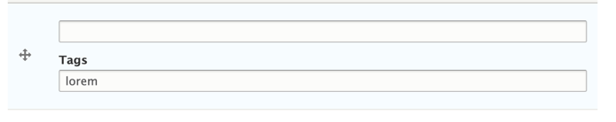

<!--
id: issues
tags: ''
-->

# Known Issues

## Cannot Tag Some Empty Items

If you try to add a tag to a textfield that is empty, and save the entity, the tag will not save.

However, if you tag an item and then later remove the value making it empty, the tag remains.

## Duplicated Entities Error

In some cases field_tag entities for a single parent entity may have duplicated deltas; this will cause errors, such as tags not saving.  To fix ...
